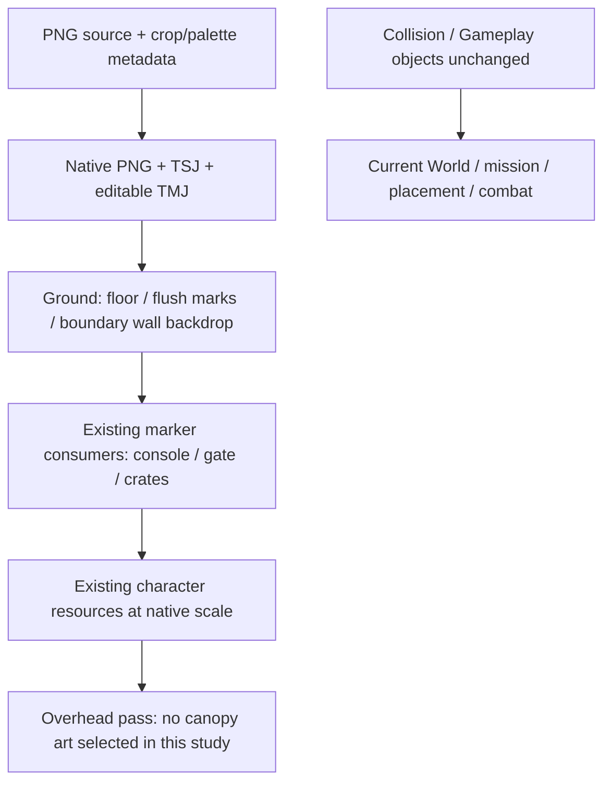

# Environment round01 · bàn giao design A/B · 2026-10-11

**Phạm vi: source study có artwork và bố cục Tiled chỉnh sửa được.** Trả round-one của
[DEV_ENVIRONMENT_DESIGN_RETURN](DEV_ENVIRONMENT_DESIGN_RETURN_2026-10-11.md) và
[hai brief](ENVIRONMENT_DESIGN_OPTIONS_2026-10-11.md).
Chưa chọn A/B; chưa chuyển default hoặc nghiệm thu chất lượng map production.

Mở [so sánh tương tác](../../build/environment_design_round_01/index.html). Trang có
toàn map A/B, bốn viewport cùng camera/scale, probe mép bắc, diagram và source GPT Image.
Không dùng ảnh AI toàn cảnh làm nền map. Raster toàn map do Tiled xuất; viewport dùng
TileMapResources/AssetResources/WorldCamera hiện có, actor tĩnh để đối chiếu tỷ lệ.

## Artifact có thể nhận ngay

| Artifact | A · phố / checkpoint | B · sân dịch vụ |
| --- | --- | --- |
| Editable map | [option_a.tmj](../../content/maps/design_round_01/option_a.tmj) | [option_b.tmj](../../content/maps/design_round_01/option_b.tmj) |
| Toàn map native | [1280×640](../../build/environment_design_round_01/option_a_full.png) | [1280×640](../../build/environment_design_round_01/option_b_full.png) |
| Regions / collision | [diagram A](../../build/environment_design_round_01/option_a_annotated.svg) | [diagram B](../../build/environment_design_round_01/option_b_annotated.svg) |
| Vào trận | [arrival](../../build/environment_design_round_01/runtime/option_a_arrival.png) | [arrival](../../build/environment_design_round_01/runtime/option_b_arrival.png) |
| Objective | [objective](../../build/environment_design_round_01/runtime/option_a_objective.png) | [objective](../../build/environment_design_round_01/runtime/option_b_objective.png) |
| Exit | [exit](../../build/environment_design_round_01/runtime/option_a_exit.png) | [exit](../../build/environment_design_round_01/runtime/option_b_exit.png) |
| Phía nam | [south](../../build/environment_design_round_01/runtime/option_a_south.png) | [south](../../build/environment_design_round_01/runtime/option_b_south.png) |
| Actor trước tường bắc | [occlusion](../../build/environment_design_round_01/runtime/option_a_occlusion.png) | [occlusion](../../build/environment_design_round_01/runtime/option_b_occlusion.png) |

[Tiled project](../../content/maps/design_round_01/environment_round_01.tiled-project),
[TSJ / crop / palette / README](../../content/maps/design_round_01/README.md),
[source / exact prompts / hashes](../../art/environment/design_round_01/generation.json),
[native receipt](../../build/environment_design_round_01/native_receipt.json),
[revision lock](../../build/environment_design_round_01/revision.json),
[technical report](../../build/environment_design_round_01/project_checks.json).
Generated PNG, preview, executable diagnostic và log nằm trong build/.

Technical snapshot cuối: **passed**,660 đầu vào không đổi;151 tests /2.025.608 assertions.
Hai encounter A/B với cùng completion profile đều exit0,148 deaths/1 blast.
Report và log kèm trên; revision còn khóa2.915 file của bank resource đã dùng bằng
`resource_hashes.tsv`. Các số này không nghiệm thu chất lượng mỹ thuật hay route playtest.

## Trả tám câu hỏi design

### 1. Đây là nơi nào, tuyến chính là gì?

**A:** phố dịch vụ tới trạm điện và checkpoint sơ tán phía đông. Bốn module mặt tiền:
shop, utility room, loading facade, checkpoint canopy. Crossing phẳng nối paving bắc
qua vùng trạm tới apron nam; road hướng đông giữ mở.

**B:** sân bảo trì điện với workshop, switchgear wall, loading door và service context.
Concrete quanh trạm chuyển sang trục asphalt phía đông; các ô loading đánh dấu vùng nam.

Cả hai giữ grid 40×20, tile32px, thế giới1280×640 và map_id `map.power_station`.
Đây là hai draft thay thế của cùng location, không phải hai nhánh renderer theo tên map.
Tuyến đề xuất: spawn(320,160) → station(360,178) → exit(1100,164).
Không di chuyển marker, không thêm nhiệm vụ hay scripted route.

### 2. Người chơi nhận ra objective và exit bằng gì?

Station dùng **console thật hiện có**, đặt trước utility/switchgear context ở x256–512.
Accent teal và lightning phân biệt với shop/workshop. Exit dùng **mission gate hiện có**
ở (1100,164), trước module context tại x1024–1152: A canopy/cross; B service canopy/arrow.
Context không có collider gate thứ hai và không thay trạng thái đóng/mở của gate.

Nguồn context riêng cho hai phương án đã có; gate/console/crates không baked vào terrain.
Tiled raster sạch ẩn object layers; viewport resource và encounter capture mới thể hiện
các sprite đó. Đọc landmark ở khoảng cách thật vẫn cần người duyệt, không mặc nhiên pass.

### 3. Vùng nam/đông để làm gì?

| Vùng | Ý định A | Ý định B | Quyết định / hậu quả cần playtest |
| --- | --- | --- | --- |
| Core x128–608,y64–320 | Tiếp cận và phòng thủ quanh console/crossing | Pad bảo trì quanh switchgear | Đặt sentry/mine gần mục tiêu hay chừa đường rút; đọc được walker và telegraph |
| East x608–1184,y96–288 | Di chuyển tới checkpoint | Làn dịch vụ tới exit | Người chơi tìm được hướng đi sau khi gate mở, không phải dò HUD |
| South x32–1248,y320–576 | Apron parking/service mở | Loading/maneuver apron mở | Chọn khoảng trống để reposition rồi quay lại station; kiểm có quá xa/trống vô ích không |
| North y32–96 | Paving trước mặt tiền | Dải bảo trì trước workshop | North wave vẫn tiếp cận core; không bị che đầu bởi facade |

Giữ west(26,160), north(340,58), south(340,296), sáu crate và spawn_bounds hiện có.
“Preparation/reposition” là giả thuyết design để người chơi đánh giá, chưa thêm reward/loot
hoặc mechanics riêng cho nam. Nếu vùng nam không tạo quyết định hữu ích, đề xuất thay đổi
layout phải có migration/route acceptance; không âm thầm crop world hay đổi tuning.

### 4. Ground palette và scale detail nào?

[Quiet source](../../art/environment/design_round_01/quiet_ground_source.png) cho bốn tile:
hai asphalt, một concrete, một warm service paving. Nearest32px, atlas64×64.
Palette authoring explicit50 màu trong
[native_style.json](../../content/maps/design_round_01/native_style.json):
asphalt `#252E34`, concrete `#39434A`, paving `#494C48`; slate/teal cho utility,
ochre/rust cho loading và ivory accent có chủ đích.

Export dùng extractor hiện có rồi `ModularRasterExport.ExportPart` ở scale1 để match
palette, giữ đúng tọa độ alpha/opaque. Đo native: ground10 màu; A48, B45; soft alpha0.
Các resource cũ giữ palette riêng, không ép đổi bank character/VFX.

Chi tiết tập trung tại mặt tiền, maintenance pad, threshold và đường đi; tránh scatter
rác/ngẫu nhiên trên combat floor. Drain/paint reuse urban_details. Pixel grain thấp hơn
source ground cũ, nhưng paving vẫn lặp và material join còn thẳng: chưa đạt terrain final.
Bốn viewport cùng640×336 và smoke combat dùng làm input review, không thay thế scrolling
playback với VFX/horde ở encounter density thật.

### 5. Đâu là floor, raised/solid?

Crossing, loading paint, drain và toàn bộ đổi màu asphalt/concrete/paving đều **flush floor**,
không collision. Chưa author raised curb, vehicle hay interior fence.

| Solid hiện có | Footprint world px | Artwork round01 |
| --- | --- | --- |
| North boundary | [0,0,1280,32] | Frontage128×32/module, chỉ trong dải này |
| South boundary | [0,608,1280,32] | **Chưa có art wall/edge đạt**, đỏ trong diagram |
| West boundary | [0,0,8,640] | **Chưa có art boundary đạt** |
| East boundary | [1272,0,8,640] | **Chưa có art boundary đạt** |

Collision và Gameplay object data khớp baseline; [receipt](../../build/environment_design_round_01/native_receipt.json).
Màu đỏ là debug diagram để chỉ solid, không phải artwork game. Paving nam/bên có thể khiến
người chơi tưởng còn đi được: không được nhận thành map final khi chưa sửa cue biên này.
Các cửa/recess trên facade là context ngoài vùng đi được, không phải portal hoặc exit mới;
B service recess cũng cần review silhouette để không gợi một lối đi xuyên tường bắc.

Crates dùng prop consumer hiện có; mission gate dùng mission-owned state/collision.
Không chuyển chúng thành static tile collider. Car/fence/concave obstacle đợi BL-024 route proof.

### 6. Layer nào dưới/trên actor?

| Layer Tiled | Pass | Ý nghĩa |
| --- | --- | --- |
| Quiet base | ground | Floor tối, không blocker |
| Flush paving and maintenance pads | ground | Floor vật liệu phụ |
| Route and loading paint | ground | Decal phẳng |
| Sparse flush fixtures | ground | Drain phẳng |
| Boundary frontage backdrop | ground | Mặt tường sau actor, giới hạn y0–32 |
| Collision | metadata only | Bốn rectangle thật |
| Gameplay | metadata only | Marker thật cho session/mission/prop consumers |

Initial study đặt toàn facade ở overhead làm che đầu Walker tại north(340,58).
Đã sửa backdrop xuống ground và xuất lại cả hai probe: actor trước tường vẫn hiện đầy đủ.
Không author canopy nhô lên playable floor trong round này; do đó **không có tile foreground**
phải bật bằng một approximation. Mái/awning thật về sau cần source foreground riêng,
extent và scene occlusion được review. Không cần Y-sort extension cho các wall-backdrop này.
Tall interior props vẫn cần depth/footprint đã chốt qua consumer phù hợp.

Diagram mô tả composition proof. Smoke capture dùng renderer game thật để đối chiếu thêm;
không coi order thủ công trong diagnostic là bằng chứng đã sửa runtime depth.

### 7. Reuse nguồn nào, thay nguồn nào?

- Reuse: urban_details drain/road/loading paint, registered console/gate/crates,
  existing character bank, tile loader/resource cache/camera, native Tiled/exporter.
- Crossroad hiện có: tham chiếu palette/camera. Không chọn noisy asphalt/mirrored full strip
  để làm floor/frontage mới.
- Warehouse: tham chiếu vật liệu công nghiệp cho B; pitch-roof/perspective của source scene
  không hợp shallow north frontage nên author module mới, không stamp whole scene.
- Extraction scene: tham chiếu context A; thay bằng frontage riêng, gate vẫn reuse đúng state.
- Car/fence studies: chưa chọn do alpha/perspective/footprint/state cần nhận và route cần proof.
- Ba source mới dùng built-in GPT Image, nguồn nằm trong art/, exact prompt/original path/hash
  trong generation.json và catalog/log hiện có. Không lấy asset ngoài không rõ usage rights.

Các atlas A/B đều có bốn module thật, mỗi module128×32; ten placements không phải ten
building designs riêng. Chỉ sinh phần đủ so bố cục; chưa nhân inventory production cho cả A/B.

### 8. Ai author, ai nhận, revision nào?

Author round này: **Codex in-thread design/character completion** theo yêu cầu người dùng.
BL-029 source/inventory owner vẫn **Codex asset preparation**.
BL-024/S01-12 shared runtime writer vẫn **Codex Sprint 01 integration**.
Environment production-art acceptance owner **Unassigned**; không tự gán người/team ngoài.
Routing: shared-workspace Markdown + preview qua chat; chưa có bằng chứng phiên dev đã đọc.

Revision: `environment.round01.ab`, khóa source/metadata/native/preview bằng
[revision.json](../../build/environment_design_round_01/revision.json).
Technical acceptance chỉ dựa report cuối `passed` và snapshot không đổi. Những report
`unstable_snapshot` trước đó được giữ riêng, không dùng để chứng nhận revision mới.
[Self-review002](../reviews/2026-10-11-002-environment-design-round-01.md) ghi thực đo và giới hạn.
Trạng thái task chỉ giữ ở BACKLOG, không nhận full map/Sprint từ số asset hoặc build pass.

## Dev làm gì sau khi người dùng chọn?

Review hai bố cục và trả lựa chọn A/B qua cùng preview. Sau lựa chọn, nhận **một** viewport
core có transition tiếp giáp và một destination, rồi sửa border cues/material joins/frontage
scale trên bộ module đã chọn. Đừng nhân batch cả hai phương án hoặc thêm blocker để lấp chỗ trống.

Shared integration owner stage map/TSJ/native đã chọn qua existing exporter và consumers,
cùng source/content hashes và executable. Nested study folder hiện không nằm trong packaged
default-map export; đây là giới hạn có chủ đích của draft chưa chọn, không phải bỏ sót runtime.
Không rewrite exporter đệ quy hay cài default bằng kết quả consultation.

Retire actor-static composition helper khi đã có matching encounter/core/east/south/occlusion
playback cho native modules được nhận; giữ source/recipe/TSJ làm canonical.
Required receipt tiếp: ranh giới walkable rõ, north wave/actor visible, landmark recognized,
joins không có patch seam, horde/shot/blood readable, current spawn/placement/hitscan/reachability
giữ đúng và report stable mới. Human route/setup acceptance S01-15/16 vẫn tách riêng.

