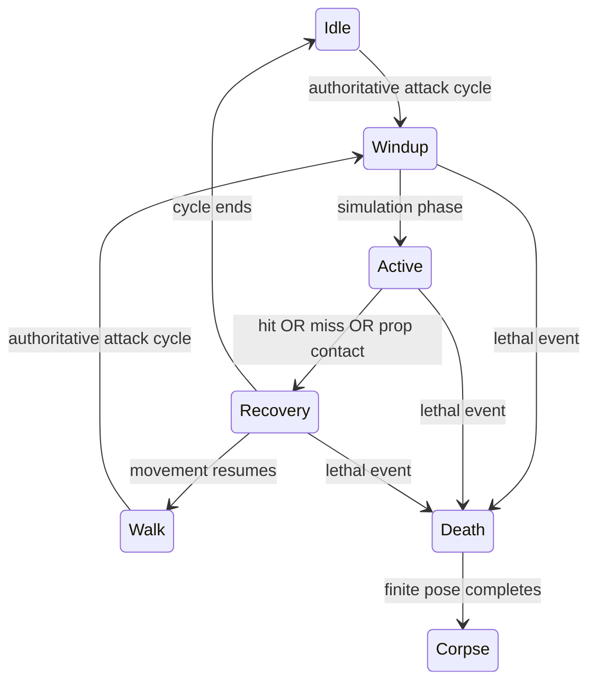

# R1b character artwork handoff · 2026-10-06

Task: BL-020 / S01-18; portrait S01-19. Authoring owner: **Codex character completion**.
Shared runtime/presentation/schema/default writer: **Codex Sprint 01 integration**.
Whole-character art acceptance reviewer and portrait UI owner: **Unassigned**.

**Contact clarification, later source study:** [revision 1](DEV_R1B_CONTACT_CLARIFICATION_2026-10-06.md)
names actual melee pose2 and Walker reaction row2 for first-Active contact, with exact candidate
hashes and measured v1 projection mismatches. This does not alter the original candidate below.
There is still no accepted numeric reload/melee weapon-angle or per-pose layer table.

**Deliverable: source/native authoring candidate.** Actual PNG parts, registration, exported
bank and action mappings now exist. This packet does not accept full R1b, promote default/olive,
certify the encounter or transfer missing design work to dev. Gait and several art-quality
items still need changes. Task status remains in BACKLOG.

## 1. Exact entry points

All paths below are relative to repository root.

| Deliverable | Path |
| --- | --- |
| Preferred unified Survivor import | `content/rigs/authoring/survivor_r1b_actions_candidate_v1_import.json` |
| Survivor action metadata, existing character schema 3 | `content/rigs/authoring/survivor_r1b_actions_candidate_v1_presentation.json` |
| Walker claw metadata, existing character schema 4 | `content/rigs/authoring/walker_r1b_claw_candidate_v1_presentation.json` |
| 48 trial grip landmarks, authoring sidecar only | `content/rigs/authoring/survivor_r1b_sockets_candidate_v1.json` |
| Portrait sources/preview policy, authoring sidecar only | `content/rigs/authoring/survivor_r1b_portraits_candidate_v1.json` |
| Unified 22-part-bank atlas, 768×2304 | `build/art_authoring/r1b_missing_actions/survivor/full/parts_atlas.png` |
| Editable 22-layer ORA | `build/art_authoring/r1b_missing_actions/survivor/full/survivor_r1b_actions_candidate.ora` |
| Native registered part banks | `build/art_authoring/r1b_missing_actions/survivor/full/parts/` |
| Native action strips / portrait source preview | [Review page](../../build/art_authoring/r1b_missing_actions/index.html) |
| Selected source hashes, prompts, generation origins | `content/art/generation_plan.json` and `art/generation/generation_log.json` |
| Previous frozen gait trial, **not accepted** | `content/rigs/authoring/walker_r1b_gait_candidate_import.json` |
| Original sole-contact study, **not accepted gait** | `content/rigs/authoring/walker_r1b_contacts_v1.json` |

The 22 banks still compose exactly six anatomical slots on one shared pose.
They are not 22 body parts and do not introduce a second character pipeline.
Twenty-four new GPT Image sources include fourteen selected sources and ten retained
unselected attempts. Six preceding gait attempts are now reconciled into the same catalog.
Historical counts in earlier generation passes are not current totals.

## 2. Selected artwork

Prefix for the following paths:
`art/characters/squad/survivor/production_v1/source/`.

| Action / slot | Selected source |
| --- | --- |
| Reload left / right arm | `reload/arm_l_v3_source.png` / `reload/arm_r_v1_source.png` |
| Melee left / right arm | `melee/arm_l_v1_source.png` / `melee/arm_r_v1_source.png` |
| Hurt torso | `hurt/torso_v1_source.png` |
| Hurt head / left / right arm | `death/head_v1_source.png` / `death/arm_l_v1_source.png` / `death/arm_r_v1_source.png` |
| Death head / torso | `death/head_v2_source.png` / `death/torso_v2_source.png` |
| Death left / right arm | `death/arm_l_v1_source.png` / `death/arm_r_v3_source.png` |
| Death left / right leg | `death/leg_l_v3_source.png` / `death/leg_r_v5_source.png` |

Hurt deliberately reuses real flinch/guard source poses, rather than coloring Walk.
Aim deliberately reuses the explicit ready pose from the existing combat bank.
Walk, idle, fire and their original timing use the existing accepted-or-candidate sources.
No gun is baked into any newly authored body part.

Preferred Death is **v2**, incorporated in the unified import. Standalone
`survivor_r1b_death_candidate_v1_import.json` and its output are retained failed alternatives:
North/South corpse and terminal limb perspective were unsuitable. Do not choose them
because their names sort first. Right-leg v2/v3/v4 and other unselected PNGs remain history.

Portrait: existing
`art/characters/squad/survivor/portraits/neutral_source.png` plus new
`art/characters/squad/survivor/portraits/determined_v2_source.png`.
The latter has a visibly changed determined expression. Preserve illustrated soft alpha
and colors; the humanoid 32-color/binary-alpha exporter is unsuitable for portraits.
Neutral hair-edge crop still needs art review and the actual UI consumer is not delivered.

## 3. Coverage, holds and packing

Every clip below contains N/E/S/W. Metadata supplies six anatomical slots per pose.

| Actor | Action | Body poses per direction / moving binding |
| --- | --- | --- |
| Survivor | idle / walk | 1 / 4; idle moving uses Walk |
| Survivor | aim / fire | 1 / 2; moving versions keep Walk locomotion |
| Survivor | reload / melee | 6 / 6; moving versions keep Walk locomotion |
| Survivor | hurt / death | 4 / 6; moving Hurt keeps Walk, Death uses finite collapse |
| Walker | idle / walk / hurt / death | Existing 1 / 6 / 3 / 6 banks preserved |
| Walker | claw_windup / claw_active / claw_recovery | 3 / 2 / 3; authored reaction-arm source rows below |

The unified atlas tiles are 192×384, four tiles across:
0–5 base head/torso/left arm/right arm/left leg/right leg;
6–7 combat arms; 8–9 reload arms; 10–11 melee arms;
12–15 Hurt head/torso/arms; 16–21 Death head/torso/arms/legs.
Existing Walk remains **four distinct poses at 150 ms**. Extra storage rows duplicate
explicit padding and are not a six-pose Walk claim. Original six native layers' first four
poses compare pixel-identically against `production_v1/pixel/parts/`.

Source grids are not a format ceiling. Some GPT Image banks produced five actual rows;
the import states the actual count and maps them into the shared timeline:
Death right arm `[0,1,2,3,4,4]`, left leg `[0,1,2,3,4,4]`,
right leg `[0,1,2,2,3,4]`. These are deliberate candidate holds, not six independently
authored limb poses. Left-leg final source row is excluded because South regresses to
boot-down; the preceding lying pose is held during final settle. Hurt has its own explicit
four-pose source mappings. Review transitions and silhouette before accepting these holds.

New action timings are **100 ms per candidate pose**, pending authority-phase/playback review.
Do not derive damage, ammo transfer or claw contact from this artist trial clock.

## 4. Walker attack phases and contacts

Reuse existing
`art/characters/zombies/walker/prototype_v1/source/reactions/arm_r_source.png`
and the compatible bandaged replacement. Their source rows are ready 0, windup 1,
strike 2, withdrawal 3, hurt 4, ready 5.

Candidate mapping: windup `[0,1,1]`, active `[1,2]`, recovery `[2,3,0]`.
The left arm balances with its authored idle pose; this is a right-arm strike.
Cap and bandaged right-arm overrides are mapped through windup, active and recovery.
Existing Death/cap banks are preserved.



The runtime integration writer consumes the simulation's typed phase/cycle markers.
A miss must still show active and recovery. Damage/contact is authoritative and applies
once; presentation observes phase and never grants damage when an image reaches a row.
The original sole-contact study describes its original hashed native legs. Do not reuse its
pixel points on regenerated gait parts without remeasuring contact landmarks and stride.

Death keeps all six parts on the shared collapse timeline, then holds their final pose
and current masks/appearance in the corpse snapshot. Later locational detachment/gibs use
[LOCATIONAL_GORE](LOCATIONAL_GORE.md); this packet does not implement hitboxes, severing,
live missing-limb locomotion or explosive gibs. Preserve the six-slot boundary for that
accepted extension rather than flattening this bank into one actor bitmap.

## 5. Required corrections and review ownership

- **Design-owned Walker gait remains Needs changes.** The frozen right-leg trial fails
  East/West planted displacement; do not integrate it as accepted gait. Existing gait/import
  selected files were not changed in this missing-action pass. Its measured finding and hashes:
  `build/art_authoring/walker_r1b_gait_candidate/authoring_handoff.json`.
- **Weapon alignment remains candidate art.** Forty-eight reload/melee grip landmarks lie on
  opaque arm pixels, but opaque does not mean a correct grip or two-hand alignment.
  Existing weapon metadata only supports `grip_px` and `after_part`; it has no per-pose
  weapon-axis angle. Some action poses change that axis. Art/dev must review with the real gun,
  muzzle/casing sockets and per-direction hand/body/gun overlap. If the boundary cannot express
  an accepted pose, its current integration owner versions contract/consumers/schema/checks
  together. Do not silently add unsupported angle keys or fake anatomy in drawing code.
- **Anatomy/ports and transitions remain unaccepted.** Preferred Death now lies in four
  directions, but South torso collar/opening, sleeve seams, torso/hip connections and clothing
  identity need review. Grounded legs use explicit holds; first-to-last pose and interruption
  continuity have not passed encounter review. Native reload/melee hand silhouettes and
  South overlap need review with weapons. Failed GPT corrections are retained and recorded.
- **Variant coverage is incomplete for the full character gate.** Walker claw cap/bandaged
  overrides exist; new compatible Survivor replacement banks were not authored in this pass.
  Test every mask and accepted replacement through the full matrix before claiming modular Done.
- **Portrait acceptance remains open.** UI consumer owner and full art reviewer are Unassigned.
  Source preview at 160×200 and 240×320 is not an actual dialogue-screen acceptance.
- Crowd readability, moving action transitions, pause/retry, actor slot reuse, corpse identity,
  all-direction swap/mask playback and actual default/olive encounters remain unaccepted.

These are design/art responsibility gaps where applicable, not proof of a developer fault.
Do not grow dependent roster/content or call full R1b Done from action names or exported PNGs.

## 6. Reproduce and verify

Reuse the existing exporter; generated files under build are not source of truth:

```powershell
powershell -NoProfile -ExecutionPolicy Bypass -File tools/assets/export_modular_character.ps1 -ImportFile content/rigs/authoring/survivor_r1b_actions_candidate_v1_import.json -OutputDirectory build/art_authoring/r1b_missing_actions/survivor/full
powershell -NoProfile -ExecutionPolicy Bypass -File tools/validation/check_project.ps1 -Configuration Release -ReportPath build/art_authoring/r1b_missing_actions/project_checks.json
```

Actual local project report:
[project_checks.json](../../build/art_authoring/r1b_missing_actions/project_checks.json),
status **passed**, source snapshot unchanged during its run.
Logs: [run directory](../../build/validation/project_runs/dc7008b059544cff95eb092485c8bb13/).
Format, source structure, Release test/game builds, headless tests and packaged-asset checks
passed; headless run reports **89 cases / 14,798 assertions**.

This report covers the integrated workspace's local technical checks. The new authoring
candidate is not selected by default, so the packaged-asset step alone does not exercise
the new bank. Separate [native checks](../../build/art_authoring/r1b_missing_actions/native_checks.json)
confirm 22 part banks, binary alpha, 32-color atlas, unchanged first four Walk poses and
48/48 opaque grip points. [Metadata inspection](../../build/art_authoring/r1b_missing_actions/metadata_checks.json)
checks all 292 body poses for direction timelines, six-slot quads and action/variant references.
Those inspections do not replace the C++ loader, actual weapons or encounter review.

Unified Survivor atlas SHA256:
`31D3377534AF0C0451A6FBDAC8A9F3DB6E8FEA0BCF424B0BB4804198A4C0E8B8`.
Exact source/content hashes are also attached in the project report and canonical generation log.
Runtime preview results, matched executable and additional freeze evidence are recorded in
`build/art_authoring/r1b_missing_actions/authoring_handoff.json`.

The freshly rebuilt `character_preview` loaded both candidate character files through the
existing C++ loader/resources/sampler/renderer and exported **38 action/pose cases**, each with
four directions and isolated part views. All capture commands exited 0; the executable hash
stayed unchanged. Every new Survivor body pose and every Walker claw phase pose was captured.
[Renderer matrix](../../build/art_authoring/r1b_missing_actions/runtime_preview/index.html),
[capture logs/report](../../build/art_authoring/r1b_missing_actions/runtime_preview/capture_report.json).
This is actual stationary renderer evidence, including the current gun and Walker variant
comparison; it still does not test authoritative transitions in the encounter or moving actions.
Review observed weapon-axis limits before selecting this art as final.

An additional input-hash recheck at 05:27:01 UTC found no changes to the project report's
input paths, 350 seconds after its initial snapshot:
[freeze evidence](../../build/art_authoring/r1b_missing_actions/freeze_recheck.json).
This recheck compares existing report paths; it does not monitor sessions or certify additions
outside that manifest. The passed entry itself captured the full integrated snapshot.

Preview executable SHA256:
`609C66D7414A7ADB96CFF752ED2B29FF29D02693DFB3D3666E505D94C69E7DFC`.
A matching standalone copy and review assets are retained under
`build/art_authoring/r1b_missing_actions/runtime_preview/`.
Example command after building the current preview target:

```powershell
powershell -NoProfile -ExecutionPolicy Bypass -File build.ps1 -Configuration Release -Target character_preview
.\build\bin\Release\character_preview.exe --presentation build/art_authoring/r1b_missing_actions/runtime_preview/assets/presentation_candidate.json --actor survivor --action reload --seconds 0.25 --capture build/art_authoring/r1b_missing_actions/runtime_preview/reload_review.png
```

## 7. Next integration and retirement gate

The nearest extension is already exported through the same importer: reload, melee, Hurt
and Death share the base rig, six anatomical slots, one atlas and existing action/locomotion
metadata. Runtime proof still needs the integration writer to consume that bank through the
existing loader/resource cache/sampler and execute the real encounter matrix.

First correct/review the design items above, then load the candidate via an explicit review
manifest; keep accepted current consumers while migration is reviewed. Review stationary/moving
actions, authoritative claw miss/recovery, sockets/weapons, masks/swaps, identity and corpse at
real size and density. Capture matching source/content/executable hashes and a fresh stable
project report after integration. Only accepted full coverage may replace default and olive;
retire prototype missing-action fallback and rotated-Walk corpse consumers after their callers
are migrated and regression-reviewed. Existing BACKLOG owner/trigger remains authoritative.

This local file makes the handoff reviewable. It does not prove another session has read or
accepted it. Sprint 01 still retains its human A/B playtests and the correction between rounds.
