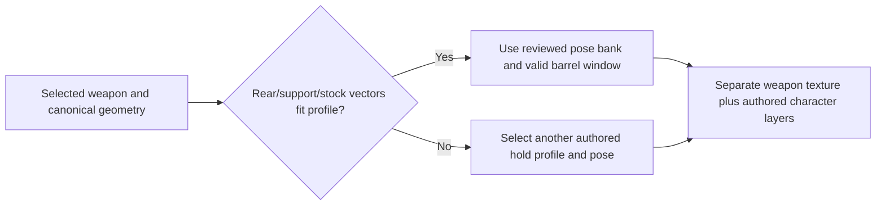

# Survivor · Base, tay cò, tay đỡ độc lập; weapon ghép riêng

2026-10-08. Character/art owner: **Codex character completion**. Runtime/import/bundle writer:
**Codex Sprint01 integration**, BL-052; actor/loadout extension retains BL-053. Scope:
**small standing-aim asset/authoring candidate + existing-resource proof**, not full character,
360° coverage or encounter acceptance. This receives the concrete
[aim-layer brief](SURVIVOR_AIM_LAYER_ART_REQUEST_2026-10-08.md) and the user's correction that
weapons must swap and the two hands need independent source authoring.

## Chọn đúng source: không có cây súng trong nhân vật

| Input | Canonical path | Meaning |
| --- | --- | --- |
| East source | `art/characters/squad/survivor/aim_layers_v1/east_split_v1_source.png` | Three columns: clean base / one trigger arm / one support arm. **No gun** |
| NE source | `art/characters/squad/survivor/aim_layers_v1/ne_split_v1_source.png` | Same separation, raised two-hand hold. **No gun** |
| Registration/import | `content/rigs/authoring/survivor_aim_layers_v1_import.json` | Cuff/palm source anchors, target anchors, retained identity/stance regions, mirrors |
| Pose/compatibility packet | `content/rigs/authoring/survivor_aim_layers_v1.json` | Bearings, draw order, valid windows, source hashes, weapon profile and consumer boundary |
| Prompts/provenance | `art/generation/survivor_aim_layers_2026-10-08.json` | Six built-in GPT Image attempts, exact prompts/origins/hashes; only two split sources selected |
| Real rifle textures | `art/weapons/rifle/rifle.png`, `art/weapons/rifle/variants/rifle_olive.png` | Separate weapon assets, never baked into the player |
| Canonical weapon geometry | `content/weapons/rifle_geometry.json` | Existing grip(10,8), stock(1,5), muzzle(35,5), ejection(16,7), barrel axis/flip |

Earlier `*_plate_*` sources contain a **construction reference column with a painted gun**.
They are unselected historical references, not runtime layers. Neither that gun nor those
two-arm groups are used in the new selected source/native parts. Do not select by filename
glob or copy every PNG into the active bank; use the explicit selected source/profile IDs.

Native output under `build/art_authoring/survivor_aim_layers_v1/native/` contains
`e/ne/w/nw_base.png`, corresponding `_trigger.png` and `_support.png`: **12 separate PNGs**,
each96×64, pivot(48,56), binary alpha/point filtering. `body_atlas.png` contains body and a
compiled foreground for the **existing** body/weapon/foreground resource proof. The separate
arm sources/PNGs remain canonical authoring inputs; compilation does not lock their source
anchors together. Production player remains full-body with authored occlusion overlays,
not a return to the six-part zombie rig or a new player dismemberment feature.

## Cách súng nằm giữa hai tay

The rifle is placed on the rear palm with its own canonical grip. The fore-end support point
must lie under the independently authored support palm, and the stock must meet the authored
shoulder. Cuffs must overlap real cloth at both arm joins. Fit needs **all** these constraints;
one correct rear socket is insufficient.

| Pose | Actual barrel bearing | Rear palm | Support palm | Stock/shoulder | Order |
| --- | --- | --- | --- | --- | --- |
| East | 0° ±5° | (54,29) | (64,26) | (45,26) | base → weapon → trigger → support |
| NE | 315° ±5° | (54,24) | (58.95,14.81) | (45.51,28.24) | weapon → base → trigger → support |
| West | 180° ±5° | (41,29) | (31,26) | (50,26) | base → weapon → trigger → support |
| NW | 225° ±5° | (41,24) | (36.05,14.81) | (49.49,28.24) | weapon → base → trigger → support |

Left counterparts mirror the same reviewed source pose. Pixel-center mirror is95−x on the
96px canvas. Metadata uses the same convention for palms/cuffs/stock. Mirroring the weapon
remains the existing canonical weapon-transform operation.

Both actual rifle textures have a usable shared fore-end point **(20,5)**. The first proposed
(20,6) was transparent on olive and was rejected before delivery. The proposal belongs in
the existing weapon geometry contract when integration versions that producer/consumer;
the authoring packet is not a second live weapon settings file. Existing rear/stock/muzzle/
ejection owners stay unchanged and all feedback uses the same resolved weapon transform.

Fixed authoring registration uses each complete forearm's cuff/palm pair. Native export
normalizes palette/alpha with existing `RasterFrameExport`, then uses System.Drawing's
standard uniform affine transform for that authored piece. No generated anatomy, independent
finger teleport, per-frame limb stretch or procedural gun. This proves one held pose, not
generic IK. Head/scarf and lower stance are retained from the current native source;7440
E/NE pixels in the declared regions match exactly. The W/NW proof mirrors those retained
parts. Existing Walk/other actions and canonical defaults are unchanged.

## Khi đổi vũ khí



- **Same compatible hold:** normal/olive rifle are demonstrated through the same sampler,
  resource cache, weapon transform and character layers. A matching reskin needs no C++
  drawing geometry change.
- **Different geometry:** compare scaled rear→support and rear→stock vectors, not only a
  weapon ID or bounding box. Source arms can be re-authored/re-registered independently;
  accept cuff/elbow/anatomy/stock/fore-end fit again. Do not move only a fist and leave a gap.
- **Different hold style:** handgun, shotgun/pump, heavy gun or another stock/fore-end spacing
  selects a matching authored profile. Unsupported combinations fail authoring/load
  compatibility until that profile exists; do not silently reuse a bad rifle pose.
- **Aim outside a received window:** select another reviewed pose before exceeding its
  window. Actual firing direction stays continuous and authoritative; never snap the shot
  ray to make the artwork appear aligned. This packet does not fill the gaps between its
  four small standing windows. Full coverage remains an explicit next art receipt.

Current runtime has one foreground frame per selected pose. This proof compiles the two
independent authored arm layers into that frame **for the checked hold profile**. It does
not claim runtime independently aimable arms, automatic arbitrary-weapon fit or completed
actor/loadout selection. If the chosen consumer needs independently transformed attachments,
the shared writer versions the existing pose/import/resource contract once and validates
the cuff/palm constraints; do not introduce a second player renderer/animator or weapon loader.

## Preview và receipt

[Interactive preview](../../build/art_authoring/survivor_aim_layers_v1/index.html) shows three
separate native parts, both actual rifle skins, native1× and enlarged cached-resource/GPU
renders. The88 captures cover four poses×11 integer barrel offsets×two skins. They use the
existing `AssetResources::draw_actor_sample`, full-body loader/sampler and weapon transform.
No painted construction gun is loaded. Exact barrel-bearing diagnostic passes no mouse target;
target/camera parallax and actual encounter still need their matching integration receipt.

Native checks passed:12 nonempty layers,31 colors,zero soft alpha/border clipping,7440 retained
pixels unchanged, each of four authored arm cells has one skin-hand component. Maximum native
palm-centroid registration error0.729px. Continuous fore-end deviation from rotating the actual
weapon within±5° is bounded by0.911px; this is geometric/model evidence, not anatomy/quality
acceptance. Two real skins load and render through the same resource consumer. Inspect native
cuff joins/hand coverage and stock contact in the supplied images before wider art production.

```powershell
powershell -NoProfile -ExecutionPolicy Bypass -File build/art_authoring/survivor_aim_layers_v1/Export.ps1
powershell -NoProfile -ExecutionPolicy Bypass -File build/art_authoring/survivor_aim_layers_v1/CheckNative.ps1
powershell -NoProfile -ExecutionPolicy Bypass -File build/art_authoring/survivor_aim_layers_v1/MakeResourceProof.ps1
cmd /c build\art_authoring\survivor_aim_layers_v1\CompileProbe.cmd
& build/art_authoring/survivor_aim_layers_v1/LayerPoseProbe.exe build/art_authoring/survivor_aim_layers_v1/preview_assets build/art_authoring/survivor_aim_layers_v1/gpu
powershell -NoProfile -ExecutionPolicy Bypass -File tools/validation/check_project.ps1 -Configuration Release -ReportPath build/art_authoring/survivor_aim_layers_v1/project_checks.json
```

[Fresh technical report](../../build/art_authoring/survivor_aim_layers_v1/project_checks.json):
passed, stable568 inputs,0 changed;133 tests/42,512 assertions. Attach
[all five step logs](../../build/validation/project_runs/ec2ccd58ce0a47f3ba8c0b1eb143811a/),
[1805-path revision lock](../../build/art_authoring/survivor_aim_layers_v1/revision_lock.json),
and [dated owner self-review RV-004](../reviews/2026-10-08-004-survivor-aim-layer-proof.md).
Both project and evidence hashes were rechecked unchanged after validation. A passed stable
local report covers technical checks only. Temporary resource fixture is a source proof; it
is not a replacement game executable and does not promote incomplete full-character coverage.

## Next same-implementation increment / ownership

The compatible olive rifle extension is already demonstrated. Character owner next authors
remaining angle/moving Aim/Fire coverage **after this small proof is received**. Runtime writer
integrates reviewed banks and compatible hold selection through the existing full-body path;
BL-053 actor/loadout binding precedes adding shotgun/roster. Independent visual reviewer stays
Unassigned until assigned, not assumed passed by self-review.

Retire temporary fixed-hand/profile-blind consumers when the shared versioned producer/import/
pose selector and matching normal/olive encounter are accepted. Migration must preserve the
actual muzzle/casing transform, action clocks, moving legs, identity, reload/melee/hurt/death
and current input/authority behavior. Return native/crowd/transition/target-parallax evidence
from the matching executable; task status and ownership remain only in BACKLOG.
