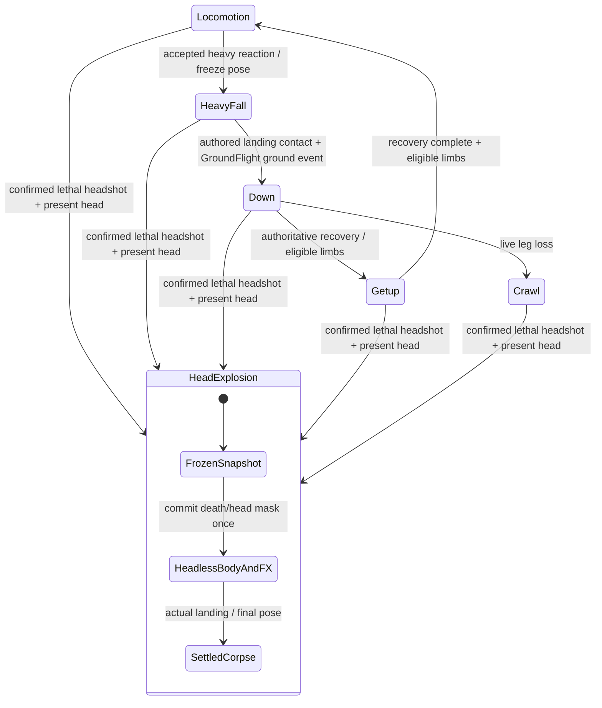

# Walker · Gait registration và cap HeadExplosion có input cụ thể

2026-10-07. Source/authoring owner: **Codex character completion**.
Runtime/shared bundle writer: **Codex Sprint 01 integration**. Loại bàn giao: **asset và
authoring candidate để tích hợp**. Đây là bộ thay thế cho hai dependency design của
[RV-004 follow-up](DEV_WALKER_RV004_FOLLOWUP_2026-10-07.md), giữ nguyên heavy bank đã nhận.
Dev có thể triển khai từ các file dưới đây; không cần chờ một sheet gait V6 hoặc sheet nổ đầu
đội mũ riêng. Không lấy browser/model làm nghiệm thu encounter hay toàn R1b.

## File nhận, không dùng study bị loại

| Input | File canonical | Output native / revision |
| --- | --- | --- |
| Gait body/variants/actions hiện có | `content/rigs/authoring/walker_r1b_gait_calibration_v1_import.json` | `build/art_authoring/heavy_recovery_v1/gait/native/parts_atlas.png`; SHA256 `4EC62569836CB0A5BC22A63C29DC591D46EC977EC8218A11681E56345AF1E3B1` |
| Gait registration/contact và 12 motion curves | `content/rigs/authoring/walker_gait_registration_v1.json` | schema1/revision1, 24 pose rows, 48 sole samples, 72 curve rows |
| Geometry tương ứng gait L4/R4 thật | `content/rigs/authoring/walker_gait_registration_regions_v1.json` | schema1/revision1,144 part frames/336 convex polygons/144 refs |
| Mũ đỏ rỗng, có animation | `art/fx/gore/walker_cap_tumble_v1_source.png` | GPT Image source1280×1280,16 cells, SHA256 `049239866900F835BC82F47BC80A0D9D03A8C8C343E83F6055407FD75246F9D1` |
| Native import mũ | `content/art/authoring/walker_cap_tumble_v1_import.json` | existing schema4 exporter,32×32/frame,4 directions×4 phases |
| Clip/placement/snapshot markers mũ | `content/art/authoring/walker_cap_tumble_v1.json` | schema1/revision1, selected,128 marker rows from six existing banks |
| Native mũ | Generated from that import | `build/art_authoring/walker_completion_v1/cap/parts/cap.png`,128×128, SHA256 `D49E926FF78A1E08C3479B201E75C7B530218AF4E31C3D8701A6AA989AE954E3` |
| HeadExplosion canonical | `content/art/authoring/walker_head_explosion_v1.json` | **revision3**; cap now selected as default anatomy FX + empty cloth attachment |
| Heavy fall/down/getup/landing | [received heavy packet](DEV_WALKER_HEAVY_RECOVERY_LANDING_2026-10-07.md) | All18 received lock inputs preserved; do not overwrite/re-author |

Sources live in `art/`, authoring in `content/`, reproducible native/evidence in `build/`.
The exact closure is `build/art_authoring/walker_completion_v1/revision_lock.json`.
Do not select gait V5 or the old rejected `head_explosion_cap_v2_source.png`.

## Gait: trọng tâm theo chân trụ, cả cơ thể cùng một transform

Giữ cycle hiện tại **13.2 units/loop**, canvas48×64/pivot24,56, sáu pose100ms ở reference speed.
Không chuyển stride8 thành mặc định và không rút ngắn cửa sổ stance để lấy số đo tốt.
Clock lấy **collision-resolved self displacement**, không dùng thời gian hoặc tốc độ yêu cầu;
impulse không tự làm chân bước. Gait packet ghi native pose của cả hai chân; Right East/West
có remap, phải dùng cùng selection cho sprite/contact/geometry.

| Pose | Load-bearing support | Registration |
| --- | --- | --- |
| 0 | anatomical `leg_l` plant | Capture resolved foot world anchor once |
| 1 | `leg_l` stance | Retain the same anchor, including heading changes |
| 2 | left release/toe drag | Fade previous whole-pose offset to zero over actual distance phase |
| 3 | anatomical `leg_r` plant | Capture the new support world anchor once |
| 4 | `leg_r` stance | Retain that anchor |
| 5 | right release/toe drag | Fade offset to zero before the next plant |

In one canonical projection:

```text
local_sole = project(resolved native sole - rig pivot)
support_anchor = final_resolved_rig_origin_at_plant + local_sole
common_pose_translation = support_anchor - projected_actor_root - local_sole
final_pose = all resolved parts + common_pose_translation
```

Apply this **once to the entire pose**, not just a leg: torso/head/arms, variants, sockets,
claw contact and region geometry use the same result. It preserves existing hip/knee joins.
Do not move the navigation/collision root a second time. Raster playback captures a
once-snapped logical origin at plant, then snaps the final origin once; independently
rounding correction, body and foot can reintroduce one-pixel drift.

The 12 curves provide explicit start/end offsets for four facings with straight and both
signed diagonals, at all six poses. They are constant-heading authoring examples; the live
consumer retains the actual anchor across a turn and uses collision-resolved motion.
They are not a second runtime tuning file or a replacement for arbitrary movement.

- **Blocked/pause:** zero distance freezes phase/registration. On authoritative teleport,
  respawn or rig discontinuity reset anchor; do not carry an old actor's anchor through slot reuse.
- **Moving claw/hurt:** leg pose/contact come from locomotion; upper-body pose comes from
  action; apply one common offset after resolution. An arm mask changes neither foot clock.
- **Missing leg:** no anchor on a removed foot; cancel standing registration and use the
  received live-down/crawl states. This packet does not disguise an absent foot as grounded.
- **Heavy/death interruption:** freeze final resolved pose/common offset, identity and masks
  before ending registration or recycling. Fall/flight/getup/landing use their authored pose
  and existing physics root, not the old standing anchor.

## Same typed transform for hit regions and presentation

The region packet is additive source-native geometry fitted with the existing RegionMeasurement
tool; its144 refs match the actual rendered native rects including Right remaps. Reuse the
existing hurt-region resolver, anatomical IDs and mask/event commit. Server-side hurt/contact
projection and client presentation must consume the same typed resolved-pose transform.
Do not calculate it only in Raylib drawing and leave authoritative hit regions behind.

Current `CharacterGait.cpp` strictly accepts `cycle_distance_units/contacts`; current samplers
do not consume whole-pose registration. These authoring packets cannot be pasted into runtime
JSON unchanged. The shared writer must version the existing character producer/typed consumer,
schema and relevant checks together, converting native coordinates through the existing
projection. No JSON/filesystem/Raylib in simulation and no client-authored damage decisions.
Do not create a second animation manager, per-limb IK solver, hit resolver or particle pipeline.

## Cap HeadExplosion: đầu thật trước đòn, mũ và anatomy FX tách sau đòn

Revision3 selects `head_cap` as **composition**, not a second anatomy texture. Capped and default
Walker have the same underlying head; the hat is clothing. Keep the actual resolved capped head
visible until confirmed lethal headshot. On the authoritative event, remove head once, freeze
native bank/pose/direction, head/cap centers, common transform, variant/mask, movement and impact.

1. Spawn existing default HeadExplosion phases `crack/rupture/separate/disperse`.
2. If that frozen actor wears the cap, spawn **one** `fx.walker.cap_tumble` cloth attachment.
3. Position the cap using the bank/native-pose marker:
   `cap_world = head_fx_world + canonical_transform(cap_center_px - head_center_px)`.
   The frozen centers already include whole-pose registration; do not apply it twice.
4. Uniform scale derives from frozen cap width divided by cap frame0 width and stays fixed.
   Each frame has its own authored pivot to prevent frame-bound drift.
5. Both start from inherited actual pre-death velocity plus accepted world-space impact.
   Existing GroundFlight then owns the cloth trajectory independently of the corpse.
   Direction follows force, not actor facing; no fixed random kick or new physics pipeline.
6. Head and cap clocks are35/45/60/90ms,230ms total. Hold the final cloth pose using existing
   configured cosmetic flight/hold/fade lifetime. No new hardcoded lifespan. No intact-head gib.

The128 markers cover gait24, R1b24, death24, live-sever24, heavy-recovery24 and death-force8
native samples. Markers are frozen authoring data, not runtime alpha queries. Match source
native pose, not action name alone. A lethal hit during down/crawl/getup uses that bank's pose.
Missing head/repeated event creates neither another burst nor another cap. Default bare-head
Walker spawns no hat. Cap is cosmetic cloth and adds no anatomy hit region.



HeadExplosion is the existing HeadSever cause profile. Headless collapse/launch and anatomy
FX/cap attachment play concurrently; animation does not decide damage or death.

## Reproduction and local evidence

```powershell
powershell -NoProfile -ExecutionPolicy Bypass -File tools/assets/export_modular_character.ps1 -ImportFile content/rigs/authoring/walker_r1b_gait_calibration_v1_import.json -OutputDirectory build/art_authoring/walker_completion_v1/gait_reexport
powershell -NoProfile -ExecutionPolicy Bypass -File tools/assets/export_modular_character.ps1 -ImportFile content/art/authoring/walker_cap_tumble_v1_import.json -OutputDirectory build/art_authoring/walker_completion_v1/cap
powershell -NoProfile -ExecutionPolicy Bypass -File build/art_authoring/walker_completion_v1/CheckInputs.ps1
powershell -NoProfile -ExecutionPolicy Bypass -File build/art_authoring/walker_completion_v1/RunModel.ps1
powershell -NoProfile -ExecutionPolicy Bypass -File tools/validation/check_project.ps1 -Configuration Release -ReportPath build/art_authoring/walker_completion_v1/project_checks.json
```

[Interactive authoring playback](../../build/art_authoring/walker_completion_v1/index.html),
[diagonal cap + moving claw](../../build/art_authoring/walker_completion_v1/diagonal_cap.png),
[blocked one-arm](../../build/art_authoring/walker_completion_v1/blocked_one_arm.png).
Playback uses actual native pixels at1×/4×. Head comparison shows all four directions and
the actual pre-hit identity followed by four composed FX phases. Debug flight shown there
is illustrative and does not replace accepted force configuration.

Native checks:16 nonempty cap frames,14 colors, binary alpha, no border clipping;48 contact
samples within1.5px of actual opaque shoes;144 shape/render refs;336 polygons;128 cap markers;
15 bound input hashes and all18 heavy lock inputs preserved. Cap PNG/atlas and retained gait
atlas re-export byte-identically. Authored curve/raster model:72/72 cases pass, four facings ×
three motion vectors × two complete support windows × three speeds,25 fractional origins and
scales1/2/4. This proves authoring/model consistency, not gait aesthetics or runtime quality.

Fresh project JSON/logs and dated self-review accompany this exact closure. Only a **passed,
stable** report supports local technical receipt. They do not certify unimplemented consumers.

Completed receipt: **Release passed**,08:29:50–08:32:41 Asia/Saigon,480 inputs/zero changed,
six steps,103 tests/21,305 assertions. [Report](../../build/art_authoring/walker_completion_v1/project_checks.json),
[matching logs](../../build/validation/project_runs/a7ccaf17faed4052a82c6a01111d3df4/),
[self-review006](../reviews/2026-10-07-006-walker-design-completion-inputs.md).
Forward the [single ZIP](../../build/art_authoring/walker_completion_v1/walker_design_completion_2026-10-07.zip):
workspace-relative source/native/import/metadata, playback, closure and matching report/logs.
It supplements this workspace; it is not a standalone runtime with those consumers installed.

## Dev receipt and nearest extension

The next implementation increment is **these received banks in the existing encounter**:
grounded gait registration + authoritative region agreement; heavy fall/down/getup/landing;
capped HeadExplosion from moving/claw/down/crawl/getup. Source quantity need not grow first.
The browser already composes moving cap/bandaged claw and masks through the same common
transform; six marker banks supply the corresponding lethal-interruption inputs. Dev returns
the same implementation in a matching executable/content candidate, not a separate demo.

Record actual straight/diagonal/turn/block stance drift across the complete support windows;
review native gait/hip joins/crowd readability, masked recovery/landing and momentum continuity.
Show pose/region overlays and head/cap snapshots before recycle, duplicate events and slot reuse.
Migrate the versioned writer/loader/sampler/region consumers together before switching defaults.
Retire temporary unregistered pose consumers at that accepted migration and prove default/olive
use the same accepted path. Current task status and owners remain only in BACKLOG.
