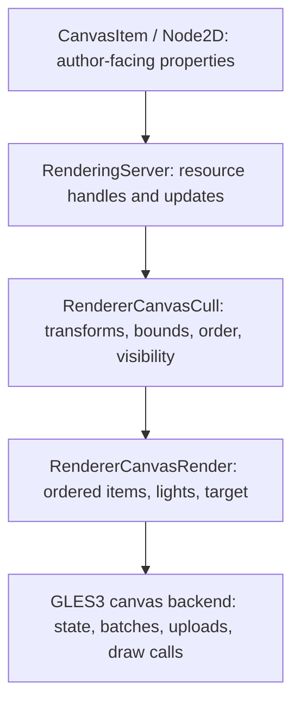

# Godot 2D rendering study for the shared Black Veil pipeline

## Question and source boundary

The user asked the root agent to study Godot's clean interfaces and optimization approach.
This is a source-backed design study, not a Godot migration or a claim that our engine now
implements those optimizations. It refines increments C-E in the
[shared rendering repair design](SHARED_RENDERING_RESEARCH_2026-11-04.md). Root owns any core
implementation; no worker is assigned an engine rewrite.

For reproducible source inspection, use Godot **4.5-stable**, commit
`876b290332ec6f2e6d173d08162a02aa7e6ca46d`. This is a fixed study baseline, not a claim to be
the latest release. Five selected upstream source files were retrieved through the GitHub
connector and retained for inspection under `build/render_research_20261104/upstream/godot/`;
`godot_files.json` records the local inspection-copy hashes. Upstream copyright/license
headers remain. No Godot code is compiled, vendored into product sources or newly licensed
as our own implementation. Godot's engine code is MIT; any later code reuse must retain its
required notice and record the exact adapted source.

## What the clean public interface actually separates

This is the inspected 2D/OpenGL path. It is not the 3D Forward+ clustered-light path.
Godot's [architecture documentation](https://docs.godotengine.org/en/stable/engine_details/architecture/internal_rendering_architecture.html)
also distinguishes RenderingDevice-based backends from OpenGL, which does not use that
abstraction. Recreating a Vulkan-style device facade above Raylib would not follow the
relevant branch of this design.

The useful boundary is between *what changed or should be drawn* and *how the backend submits
it*. The public interface is supported by substantial backend code and explicit lifecycle,
not by a single generic `Engine` class. Our equivalent can remain much narrower because we
already selected C++17, Raylib and one game-specific visibility policy.

## Findings from the pinned source

| Mechanism | Exact upstream evidence | Consequence for our implementation |
| --- | --- | --- |
| Coalesce redraw requests | [`CanvasItem::queue_redraw`, line 452](https://github.com/godotengine/godot/blob/876b290332ec6f2e6d173d08162a02aa7e6ca46d/scene/main/canvas_item.cpp#L452) returns when an update is already pending and defers the redraw callback. | Rebuild retained geometry/commands when inputs change; do not rebuild identical art submissions for each consumer. This is not permission to defer simulation or sight correctness. |
| Separate transform updates from geometry authoring | [`canvas_item_set_transform`, line 629](https://github.com/godotengine/godot/blob/876b290332ec6f2e6d173d08162a02aa7e6ca46d/servers/rendering/renderer_canvas_cull.cpp#L629) updates item state; [`canvas_item_add_texture_rect`, line 1513](https://github.com/godotengine/godot/blob/876b290332ec6f2e6d173d08162a02aa7e6ca46d/servers/rendering/renderer_canvas_cull.cpp#L1513) records a draw command. | Keep authored geometry/UVs immutable; actor position, animation sample and light changes are separate dynamic data. |
| Reuse bounds unless dirty | [`Item::get_rect`, line 36](https://github.com/godotengine/godot/blob/876b290332ec6f2e6d173d08162a02aa7e6ca46d/servers/rendering/renderer_canvas_render.cpp#L36) reuses eligible cached bounds and recomputes when required. | Preserve `TileMapResources` prepared bounds; make the dependency of any new derived bound explicit. An animated/raised sprite needs its correct visual bounds, not only its collision footprint. |
| Common culling and ordering | [`_attach_canvas_item_for_draw`, around line 249, and `_cull_canvas_item`, line 293](https://github.com/godotengine/godot/blob/876b290332ec6f2e6d173d08162a02aa7e6ca46d/servers/rendering/renderer_canvas_cull.cpp#L249) use clip intersection, visibility masks, transforms and ordered lists; children sort only when their order is dirty. | One map-independent preparation path should produce the correctly ordered visible submissions. Do not bake a different renderer for each room or map. |
| A concrete backend contract | [`canvas_render_items`, line 504](https://github.com/godotengine/godot/blob/876b290332ec6f2e6d173d08162a02aa7e6ca46d/servers/rendering/renderer_canvas_render.h#L504) receives a render target, ordered items, light lists, transform and filtering policy. | A frame/pass description should carry its inputs explicitly. The backend should not recover its purpose from unrelated mutable booleans. |
| Batch according to compatible state | [GLES3 batch recording, lines 592-646](https://github.com/godotengine/godot/blob/876b290332ec6f2e6d173d08162a02aa7e6ca46d/drivers/gles3/rasterizer_canvas_gles3.cpp#L592), and [`_record_item_commands`, line 813](https://github.com/godotengine/godot/blob/876b290332ec6f2e6d173d08162a02aa7e6ca46d/drivers/gles3/rasterizer_canvas_gles3.cpp#L813), split batches on relevant clip/material/filter/repeat changes. | Count our state transitions first. Combine only adjacent compatible submissions; transparent/depth ordering remains authoritative. |
| Filter light influence | [Per-item light selection, line 857](https://github.com/godotengine/godot/blob/876b290332ec6f2e6d173d08162a02aa7e6ca46d/drivers/gles3/rasterizer_canvas_gles3.cpp#L857) considers source validity, masks, Z range and bounds overlap. | A measured broad-phase candidate list can narrow expensive sampling. Do not use observer facing to disable physically active lights. |
| Explicit GPU-state boundary and accounting | [Canvas entry, line 107](https://github.com/godotengine/godot/blob/876b290332ec6f2e6d173d08162a02aa7e6ca46d/drivers/gles3/rasterizer_canvas_gles3.cpp#L107) resets canvas state; the backend records rendered items/primitives/draw calls. | Make pass entry/exit predictable and expose counters for the actual bottleneck. A class-name cleanup alone is not a performance result. |

Retaining commands does **not** mean a visible sprite is rendered only once forever. Geometry
construction and draw submission are different costs. Godot can keep commands while still
culling/submitting visible content each frame. Its RID handles also require explicit resource
ownership/freeing; adopting a handle name would not solve a stale-resource bug automatically.

## Compare with the current project before adding anything

| Already present here | Keep and extend | Specific remaining boundary |
| --- | --- | --- |
| `AssetResources` / `TileMapResources` cache textures and prepared tile geometry | Existing imports, atlases, UVs, visual bounds and native Tiled authoring | Do not introduce a second asset catalog or parse JSON during drawing. |
| `WorldRenderer` orders map objects and actors by authored ground/depth | Shared ordered item stream and actual asset snapshots | Pass and material state should be explicit without allowing texture sorting to reorder translucent art. |
| `Perception` owns numeric light/LOS; `SightScene` owns derived masks and memory | Current source revisions, old/new dirty light bounds and observer invalidation | Add independent diagnostics first; tighten lifecycle before in-place map replacement. |
| `SightComposite::surface` flushes pending Raylib work before changing uniforms | Required ordering/synchronization | It also performs repeated uniform lookup/binding and relies on pass flags. Measure and centralize this state before trying to skip calls. |
| Full-world memory and surface-reference targets | Preserve exploration and ground registration semantics | Large maps have an allocation/bandwidth cost. Viewport or chunk targets need boundary/memory equivalence, not a one-map shortcut. |

## Proposed smallest interface improvement

The following describes the next migration, **not new implemented classes**:

- One immutable **frame view** carries camera, observer definition and the already-resolved
  light/mask resources. Global shader locations are resolved at shader creation, not repeatedly
  looked up by string for every sprite.
- One typed **pass description** names live world, memory write, memory display, surface
  registration or terrain background, with its target and clip. Entering/leaving a pass has
  scoped ownership of the actual Raylib state it changes.
- One complete **surface description** specifies ground/depth policy, local-player/snapshot
  policy, opacity and optional projection footprint. A single binder initializes all relevant
  uniforms, including explicit values when a feature is absent. No state inherits accidentally
  from the previously drawn wall or actor.
- Keep the existing ordered draw items. Add a batch key only after measurement: shader/pass,
  textures/samplers, blend/clip and every per-draw uniform affecting output. Current per-actor
  ground Y may legitimately split batches; making it an instance attribute is a later measured
  backend change, not something fixed by deleting a flush.

All consumers migrate together: live ground, depth-sorted objects/actors, overhead/cutaway,
remembered actors, memory writes and surface registration. Remove superseded boolean paths
after equivalent native output on both maps. No parallel legacy/new renderer selected by map.

Raylib batches work internally. Mutating a uniform before queued geometry is submitted can
change which value earlier sprites receive. Its auxiliary sampler bindings also participate
in batch lifetime. A state cache must own that boundary; a global `if (same_state) return`
around `surface()` is not an accepted optimization.

Concrete first optimization candidate: the current `surface()` calls `GetShaderLocation` for
`lightField`, `surfaceReferences` (except registration), `opaqueSurface` and `projected`, plus
`exploredTerrain` for that pass. These shader locations are stable for the shader lifetime.
Resolve/validate them once alongside the already-cached mode/ground/opacity locations. This
removes repeated name queries while preserving every required flush and binding. The source
count establishes redundant lookup opportunities, **not a measured speedup**. Do not change
texture binding lifetime or shader semantics in the same first optimization.

## Configuration and measurement

Keep light profile, sight range/cone, terrain darkness and cutaway tuning in the existing JSON
and Tiled owners listed in the parent design. Pass identities, dirty dependencies and correct
GPU synchronization are code contracts. Future budgets/chunk sizes become validated settings
only when their implementation and overflow/boundary behavior are demonstrated. Do not import
Godot's internal numeric limits as new gameplay limits.

The official [CPU-rendering optimization report, 2026-09-15](https://godotengine.org/article/rendering-cpu-optimizations/)
emphasizes finding a measured hotspot, understanding it, changing it and measuring again. It
also shows why extra caching can lose when memory traffic is the actual bottleneck. Apply that
method, not the article's results or hardware numbers, to our game. The official
[GPU optimization guide](https://docs.godotengine.org/en/stable/tutorials/performance/gpu_optimization.html)
distinguishes draw/state overhead from pixel cost and recommends reuse of compatible materials
and shaders; neither guarantees a speedup for this project without a controlled run.

Measure one fixed gameplay/camera/input sequence in Release, with the same native assets:

1. CPU scene preparation, light/LOS sampling, mask updates and draw submission separately.
2. Draw calls/batch breaks by reason, uniform/texture changes, cells recomputed and uploaded bytes.
3. Render-target allocation and memory; actual GPU timing if instrumented. CPU submission/swap
   duration is not isolated GPU timing.
4. p50/p95/p99, worst frame at gate/light changes and the first entering-room frame. Preserve the
   configured crowd and stress requirements. Low-rate diagnostic captures are not these numbers.
5. Pixel equivalence and observer/occlusion/memory correctness before accepting the optimization.

Keep a light whose emitter is offscreen if its influence reaches visible receivers. Keep a
raised wall/roof if its visual extent reaches the camera even when its ground anchor does not.
Render culling must never suppress authoritative gameplay or change what the observer knows.

## Decision for the next core increment

Borrow Godot's explicit update/cull/submit boundaries and retained-data discipline through the
existing project modules. Start with the typed pass/surface binder and cached uniform locations,
proving existing pixels before optional batching changes. Then use measured counters to select
light broad-phase, upload granularity or target sizing. Do not combine all three optimizations
with a renderer rewrite: that would erase the evidence needed to attribute an improvement or
regression. Godot's low-level renderer depends on its own core/resource/storage system and is
not a standalone Raylib component to copy into this codebase.
