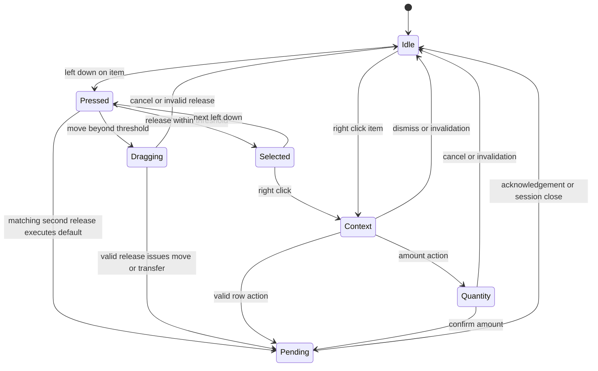

# Inventory context actions and direct manipulation

## Decision, scope and references

User direction: right-click an item to see its relevant actions; double-click executes the
top/default action. With storage open, that action is transfer to the opposite inventory.
With only the player's case open, a compatible item is selected/equipped for use in hand.
Remove the requirement to select an item and travel to a separate action-button strip.

Task BL-117. Root owns action/input/command integration; presentation and validation work
can be delegated with separate file ownership. The initial deliverable was **design and an
interactive local interaction study**. The follow-up C++ runtime slice is now committed and
under integrated/native validation. Historical candidates retain the old action strips and
immediate drag-on-press behavior; the browser study alone never accepts the runtime change.

Reference: Obsidian's [Grounded 0.2.0 notes](https://www.obsidian.net/news/grounded/august-content-update-notes)
document inventory context actions and direct stack transfer. The
[Grounded 2 0.2.2 notes](https://grounded2.obsidian.net/news/grounded-2/dec-features-update)
also record item movement/input fixes, reinforcing the need to test pointer behavior.
These references inform the design; they do not establish exact current mouse mappings or
menu ordering in both games. The rules below are Black Veil's user-directed contract.

## One gesture, one intention

| Input | Player case alone | Two panes: player and open storage |
| --- | --- | --- |
| Single left click | Select, highlight and show details | Select that item in its actual pane |
| Double left click | Execute the first safe default action | Transfer the clicked item/stack to the other pane |
| Right click | Select the targeted item and open its menu | Open the item's menu with Take/Store first |
| Hold left and move beyond drag threshold | Drag/rearrange; rotate while dragging if permitted | Rearrange player case; crossing to the other pane requests transfer |
| Release without crossing drag threshold | Keep selection; send no Move command | Keep selection; send no transfer unless a double-click completed |
| Escape | Close context/quantity popup first, then inventory on a later press | Same; closing storage invalidates its context immediately |

Clicking another grid cell is never an action-selection mechanism. A focused item remains
visible beneath the context menu. Selecting a new item does not change its grid position.
Dropping outside the UI is **not** an implicit world Drop: it cancels the drag. World Drop is
an explicit labeled action, preventing accidental disposal near a panel edge.

Double-click means two complete clicks on the same item identity and pane within the configured
interval and pointer tolerance. Execute on the second release. The opening interaction that
reveals a chest cannot count as the first click. Click history is cleared on pane/source change,
scroll, drag, context/quantity popup, overlay close, actor/session change or item invalidation.
The listener identifies the entire multi-cell item, not a raw grid cell.

## Default action and stable menu ordering

| Clicked item/context | First row / double-click | Further supported rows |
| --- | --- | --- |
| Own firearm or knife; own case only | Equip | Unload (firearm with rounds), Split if eligible, Drop |
| Own grenade or flare; own case only | Select throwable | Split if stackable, Drop |
| Own packed sentry or lamp; own case only | Deploy | Drop; Inspect charge/ammo/HP in details |
| Own ammo/material/supply with no usable handler | Inspect (nonmutating) | Split if eligible, Drop |
| Storage item; both panes open | Take stack → Backpack | Take amount… if quantity > 1; Inspect |
| Own item; both panes open | Store stack → named container | Store amount… if quantity > 1; then compatible Equip/Deploy/Select, Unload, Split, Drop |
| Already equipped weapon; own case only | Equipped (disabled) | Other relevant actions; no toggle-to-unequip on double-click |

For a one-item instance, use Take/Store item rather than stack. For stacks, the default
requests the **whole clicked stack**, not the whole container. Amount transfer opens a compact
quantity editor with an integer field, bounded step controls, Confirm and Cancel. It remains
anchored to the same item/pane/source; opening it does not transfer anything.

Keep the contextual first row in position even when blocked. If storage is full or read-only,
double-click reports that failure and transfers nothing; it must **not fall through to Equip,
Deploy, Split or Drop**. A disabled default remains visibly marked as the default. Valid
secondary actions can still be chosen explicitly. Hide actions the item never supports;
temporarily blocked actions stay visible with a concrete reason.

Labels express direction and quantity: `Take stack (24) → Backpack`, `Store → Supply case`,
`Unload 8 rounds`. Show the actual destination name in both pane title and action. Do not
offer Repair, Upgrade, Use, Consume, Bind or Destroy until the underlying system supports it.
Do not invent a consumable effect for items merely because they use the Supply kind.

Drop is always below a separator, never the default. Existing equipped weapons may be stored
or dropped through authoritative ownership rules; update the in-hand loadout consistently and
show that consequence. No silent item destruction is introduced. Take All remains a labeled
container-level command, not an item default. It requires its existing per-transfer accounting.

## Partial transfers and state feedback

Reuse the existing stack/capacity rules. When the destination fits only part of an ordinary
stack, transfer the amount actually accepted and retain the remainder in place. Show a receipt
such as `Taken 12/24 — backpack full`; do not report a complete stack transfer or lose the rest.
Instance items keep the same loaded rounds, upgrades, HP and remaining battery when transferred.
No world placement, refill or recharge occurs merely by moving a packed device between panes.

While a command awaits its acknowledgement, mark its row/item pending and reject duplicate
mutations across both panes. Do not visually remove an item before authority accepts it.
After success, preserve selection if the same item still exists; otherwise clear it without
retargeting the newly exposed item. Failure preserves layout, stock/quantity and ownership.
Receipts say what happened, with a visible failure reason, without blocking the entire screen.

## Context-menu presentation

Reuse the existing tactical 9-slice panel, border, normal/hover/disabled skins, text and pointer
resources. No newly generated artwork is required for this interaction slice. Render icons,
labels, shortcut hints and disabled reasons separately from the skin. Maintain readable text
at high DPI through the existing text viewport path; use the same UI coordinate transform
for rendering and hit testing.

Anchor near the clicked item, then clamp/flip the menu inside the safe canvas. Do not cover the
item if an adjacent placement fits. Limit height to the viewport and scroll when necessary.
Menu rows size to label/font metrics and configured padding; no per-item rectangle literals.
Default row has a subtle marker and a `Double-click` hint. No permanent action-button grid is
needed beneath the case; keep details, capacity, global Shop/Close and optional key hints.

Right-clicking another item moves the menu to that identity. Clicking outside dismisses and
consumes that press; it must not fire, aim, drag or activate something behind the menu. Right
click during an active drag cancels the drag, and does not open another menu on the same input.
Escape/cancel also consumes the input until release. Context/quantity overlays draw above both
inventory panes, outside world lighting, and do not pause the live mission.

Keyboard access: item focus, a configurable Context Menu key (including Shift+F10 binding),
Up/Down to navigate, Enter to activate the selected enabled row, Escape to dismiss. The
configured primary-action key uses the same resolver as double-click. Do not make destructive
actions the Enter fallback when the default becomes unavailable.

## Input arbitration: fix the first-click drag problem

The existing controller begins a draft immediately on left press and emits Move on release,
even when the user only selected the item. That path must migrate before adding double-click.
Otherwise the first Move can change the inventory revision or set pending, causing the second
click to be rejected, or the item to jump while opening a menu.

Store a press candidate and original placement first. Only create an actual drag draft after
crossing the movement threshold. A click or right-click must never queue a no-op Move. Use a
presentation/input monotonic clock or injected UI timestamp, not simulation ticks: gesture
recognition must not vary with pause, simulation rate or low FPS. Simulation stays independent
of wall-clock APIs.

Load double-click interval, pointer tolerance, drag threshold, menu metrics and quantity
editor bindings once through the existing app/presentation configuration boundaries. Initial
review values may use OS double-click settings with a configurable override; DPI transforms
must be explicit. Action semantics and network/ownership checks are structural contracts,
not per-item scripting or per-map toggles.

## One action resolver, existing authoritative commands

One typed item target contains actor/session identity, pane, item ID, source slot/generation
and observed inventory/source revisions. Do not retain a raw item pointer between clicks.
A shared resolver returns ordered action descriptors: stable action ID, label, enabled state,
reason, default marker and quantity policy. Context menu, double-click, primary key and optional
shortcut hints all consume that result. The renderer does not decide permissions.

Use the existing typed operations:

| Intent | Current authoritative route |
| --- | --- |
| Equip/select throwable | `InventoryOperation::Equip` |
| Start deploy preview | Existing `take_deploy_item` handoff, then timed world transfer |
| Rearrange/split/merge | Existing inventory Move/Split/Merge |
| Take/store | Loot Take/Store with both revisions |
| Drop/unload | Existing Loot Drop/Unload |

Use one mutation dispatch/pending owner across the case and container. The current controller
has separate pending paths; don't let right-click queue both an inventory and loot command in
one frame. Refuse or refresh stale targets, revalidate at dispatch, and let simulation enforce
ownership, range, source search/access, stock and capacity again. Never retry against a different
item that later occupies the same slot. Queue no action while a drag/quantity transaction owns
input. Clearing context cannot clear an already accepted world transaction.

Closing a source, leaving range, damage/death/mission transition, a changed opened-sequence,
another actor taking the item, or authoritative revision changes invalidate context immediately.
Refresh the UI, reset click history and do not redirect a stale action to the player case.
Shop mode has its own purchase actions; double-clicking a shop offer must not masquerade as
container Take or make purchases without an explicit separately accepted shop interaction.

## Existing source changes required

- `CaseController::arrange`: replace press-to-draft with click/drag arbitration and the shared
  primary action; include melee weapons in actual equip dispatch (renderer currently offers
  them but that branch checks only firearm/throwable).
- `CaseLootController`: target-specific Take/Store and shared pending dispatch; migrate its
  three-button strip, keeping source lifecycle/ack/take-all semantics.
- `CaseView` and the existing overlay lifecycle: store context target/menu focus/quantity state
  and clear them together on close/reset. Runtime item data stays owned by World.
- `CaseRenderer`, `LootPanelRenderer`, shared geometry: draw/hit-test the same resolved menu
  bounds and existing 9-slice assets. Remove the redundant item action strips after migration.
- Inventory layout loader/schema: version new input/presentation settings and update exporter,
  runtime consumers, checks and native fixtures together.
- Retire old action-button-only input tests with new gesture tests that verify actual item IDs,
  quantities and equipped state, rather than only coordinates or screenshots.

## Acceptance and delivery

Local interaction study: [open the exported page](../../build/inventory_context_design/index.html).
Its [source and exporter instructions](../examples/inventory_context_study/README.md) remain
tracked; generated PNG/HTML evidence does not. The study uses sample data and browser gestures,
not the game commands. Its explicit limits must remain visible during review.

First integrated slice must cover own-case firearm/knife equip, packed-device deployment
selection, storage Take/Store for instances and stacks, Drop/Unload/Split menus, and pending/
stale guards through the existing systems. Do not claim completion from a popup that merely
draws labels. Root owns shared integration; preserve seamless live gameplay.

Required tests and native input evidence:

1. Single click changes only selection and does not change inventory revision.
2. Double-click a weapon/knife in own case equips that exact instance once. An already-held
   item is not toggled away; unsupported Supply never drops or consumes on double-click.
3. With storage open, double-click either pane transfers in the correct direction; it never
   equips as fallback. Read-only/full/missing targets leave the default blocked and harmless.
4. Whole-stack, partial-fit and exact-amount transfer receipts match accepted quantities;
   loaded weapon/device state survives transfer, drop and pickup.
5. Right-click works on a nonselected item, at all screen edges and high DPI. Drag threshold,
   rotation, cancellation and the second-click window do not race a no-op Move acknowledgement.
6. A triple click, slow acknowledgement, fast acknowledgement, replaced item slot, different
   source generation, pane reopening and retry cannot duplicate or retarget a command.
7. Menu/quantity clicks never leak to shooting/aiming/world deployment; combat continues while
   browsing. Source closure/damage cancels UI context using its existing lifecycle rules.
8. Shop, Take All and keyboard/controller focus remain functional through their actual command
   routes. Their labels must not imply item-level actions apply globally.

Run stable project checks and package a revision-matched candidate after integration. Generate
native screenshot/input receipts and keep build output outside Git. Human review should time
the common tasks (equip, retrieve/store, drop a stack) and verify they are understandable
without finding distant action buttons. The study linked below is not that runtime evidence.
