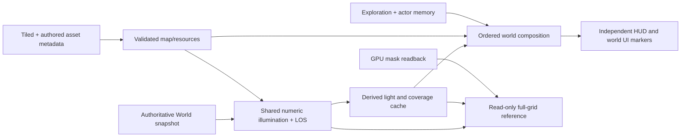

# Shared rendering: research, diagnosis and incremental repair

## Scope and ownership

Follow-up to [RV-002](../reviews/2026-11-04-002-rendering-pipeline-investigation.md),
baseline `26d463d`. The user requests researched, reusable, configurable improvements and
explicitly assigns core engine/render changes to the root agent. Root owns the architecture,
presentation implementation, integration and final review. Bounded workers provide read-only
research and independent validation-script work. Status remains in BL-114 and BL-093.

This increment is a **diagnostic runtime slice plus repair design**, not acceptance of every
reported lighting/asset defect. Its first consumer is the existing Service Court renderer;
the nearest extension is the same inspection on the smaller lighting map and later post-Gate-A
rooms. A passing cache comparison does not establish correct final composition or artwork.

## Research and reuse decision

The user's Godot follow-up is covered by the
[pinned source/interface study](GODOT_2D_RENDERING_STUDY_2026-11-04.md), including exact code
references, retained commands, dirty bounds, culling/batching and the proposed narrow migration.

Primary sources inspected on 2026-11-04:

| Source | Relevant evidence | Application here |
| --- | --- | --- |
| [Raylib 6.0 fog-of-war example](https://github.com/raysan5/raylib/blob/6.0/examples/textures/textures_fog_of_war.c) and [core implementation](https://github.com/raysan5/raylib/blob/6.0/src/rcore.c) | Render targets, shaders and texture readback already belong to the pinned graphics backend. The example maintains explored state separately. | Reuse existing Raylib calls and our current memory targets; do not import its sample gameplay/grid as another sight system. |
| [Godot 2D lighting documentation](https://docs.godotengine.org/en/stable/tutorials/2d/2d_lights_and_shadows.html) | Ambient modulation, light emitters, occluders and receiving layers have distinct roles. Lights and observer knowledge are different concepts. | Keep light power and light-to-surface occlusion separate from observer LOS/range, memory and UI admission. This is an architectural inference, not a recommendation to port engines. |
| [Tiled layer documentation](https://doc.mapeditor.org/en/stable/manual/layers/) | Layer/group order, offsets and opacity affect drawing; freely placed objects carry independent properties. | Preserve Tiled as authoring authority, validate our supported semantics and inspect visual-ground/collision registration rather than patching a map name in C++. |
| [Qt Quick renderer documentation](https://doc.qt.io/qt-6/qtquick-visualcanvas-scenegraph-renderer.html) | Retained geometry and batching reduce submission work; translucent ordering constrains reordering. | Retain prepared tile geometry and depth/alpha ordering. Measure material-state changes before changing batches; do not reorder transparent sprites just to reduce draw calls. |
| [Dirty Flag, Robert Nystrom](https://gameprogrammingpatterns.com/dirty-flag.html) | Cached derived data must be invalidated whenever its source changes. | Make invalidation observable and compare it with a full computation before adding more incremental update paths. |

Reuse assessment: Raylib 6.0 is already linked, pinned and compatible with C++17/MSVC. Its
zlib/libpng license is already packaged. Godot and Qt are architecture references here, not
new dependencies or copied code. No upstream implementation was copied and no external
source needs to be vendored for this increment. Reading the specific upstream files is
sufficient; cloning complete engine histories would not improve this bounded diagnosis.

## Responsibilities that must remain separate

The lamp's power, physical light pool, observer visibility, remembered sprite and final
displayed pixel are separate values. An enabled lamp does not prove its receiver is visible;
a visible lamp sprite does not prove the pool was drawn. A wall may validly obstruct light,
observer LOS, or both. None of these rules may depend on a scene's name.

Current cache inputs already include observer position/facing, effective range/cone,
blocker values and dynamic-light changes. Retain them. Current scene recreation/reset
already handles normal session boundaries. A map/content generation key is needed before
in-place map replacement, not as an unsupported explanation for today's defect.

## First implementation: inspect before changing behavior

`SightScene::inspect_cache()` is an explicitly requested, read-only operation after observation.
It recomputes the entire grid using the shared numeric policy, bypassing dirty rectangles,
cached light samples and the observer's bounded traversal. It reports mismatched cell counts
and the first cell separately for:

1. Direct light samples.
2. Surface light samples.
3. Coverage/LOS/snapshot mask bytes.
4. Encoded light bytes.
5. GPU coverage texture versus the CPU upload buffer.
6. GPU light texture versus the CPU upload buffer.

The query neither advances World/animation nor clears actor snapshots/explored terrain. It
uses the exact observed tick and light revision. GPU readback is requested after normal draw
submission; it is expensive and never runs in normal gameplay or an ordinary HUD inspection.
The existing native probe enables it through fixture `verify_sight_cache: true`. Its report
records the tick, grid size, revision and each stage. Missing sight is an explicit error.

The reusable checker derives diagnostic fixtures into `build/`, retains originals and writes
PNG/JSON/hash evidence plus an offline `index.html`. An optional diagnostic render rate controls
submission frequency only; it does not lower simulation density, change damage or weaken the
canonical stress check. Inspection time is not an FPS result.

This reference deliberately shares the authoritative light/LOS formulas. It detects stale
derived data and upload disagreement, not a mathematical bug shared by both paths. Existing
numeric tests and final-pixel light/zoom/wall checks remain necessary. Full-frame cached/fresh
composition and visual-ground registration are separate follow-up coverage, not implied here.

## Configuration ownership

| Concern | Existing owner | Change/lifetime contract |
| --- | --- | --- |
| Ambient brightness, light gain, colors, falloff, radius, cone, reveal threshold | `content/lighting/environment.json`, validated lighting definitions | Load once; immutable for the scene. Recreate dependent resources on configuration reload. |
| Light positions, facing, activation, collision/LOS and surface projection | Tiled map/tileset metadata under `content/maps/` | Author per map; all maps use the same loader/renderer. Motor activation supplies authoritative dynamic snapshots. |
| Personal/illuminated range, angle, traits and map restrictions | Existing gameplay perception/profile definitions | Pass the resolved typed observer definition into numeric queries and shader uniforms together. |
| Unknown/explored luminance, saturation, edge/fade presentation | `content/presentations/sight_style.json` | Presentation-only tuning; never reveal hidden actors by increasing a terrain baseline. |
| Diagnostic captures, sample points, render rates | Versioned QA fixtures and explicit checker arguments | Opt-in validation only; no production frame cost. |
| Pass identity, resource lifetime, cache dependencies, alpha/depth ordering | Shared C++/GLSL contract | Structural correctness, not designer tuning or per-scene JSON workarounds. |

"Configurable" means changing authored behavior through its canonical owner. It does not mean
exposing a switch to skip invalidation, disable required wall occlusion or select an optimizer
for each map. New settings require a demonstrated consumer, validation and schema migration.

## Repair sequence and acceptance

| Increment | Root implementation and evidence | Exit criterion |
| --- | --- | --- |
| A: trustworthy diagnostics | Full-grid cache/reference + GPU upload comparison; strict rate-independent visibility checker; native small-map and Service Court captures | No missing data can count as a pass; each discrepancy identifies its first stage. Preserve exact source/executable/config provenance. |
| B: reproduce current symptom | Fixture for an affected fixed/motor/portable/flare source; turn, aim release, zoom, doorway/roof, fresh/explored and retry transitions | A recorded failure on the delivered content, followed by a targeted correction and passing reproduction. Keep the wider report open otherwise. |
| C: explicit composition boundary | Replace distributed flag combinations with named pass/surface state and one complete uniform binder; scope actual Raylib state changes | Old/new full-frame pixels match on both maps except intentional fixed cases; exceptions/early exits cannot leak pass state. Do not introduce a generic engine facade. |
| D: lifecycle and registration | Bind scene resources to a proven content/session generation before same-ID replacement; validate visual-to-footprint references and depth | Retry and the next accepted map transition preserve/reset precisely documented memory; doors cannot retain invisible blocking art or stale registration. |
| E: measured optimization | Profile submission, mask update, sample counts and texture allocation; only then consider bounded uploads or viewport/chunk targets | Equivalent pixels and gameplay on the same input, recorded p50/p95/p99 and memory. Preserve light/memory across region boundaries. No unmeasured FPS claims. |

For B, an equal cached/fresh result narrows the search to the shared policy, registration,
composition or artwork; it does not absolve the renderer. A GPU-only mismatch identifies the
upload/state boundary. A CPU mismatch localizes invalidation or bounded traversal. Inspect
native pixels and asset alpha/POV separately from numeric data.

For C, retain Raylib's batching flush before mutating per-draw uniforms. A typed interface
must not silently remove that synchronization. No grouping by texture across actor/depth
boundaries without equivalence evidence. For E, current full-world color targets alone imply
120 MiB on Service Court; this is an estimate, not measured driver allocation.

Gate A remains separate from closing BL-093. Full local technical checks are required for
runtime handoff, and a current candidate/receipt is required before calling a new build
playable. No amount of new decoration, successful builds or abstraction names accepts the
reported partial-light/incorrect-artwork problem without its reproduction and native evidence.
